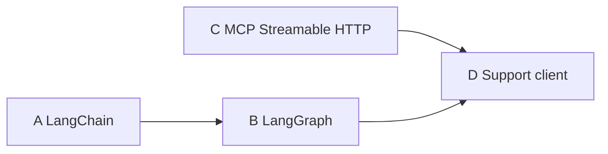
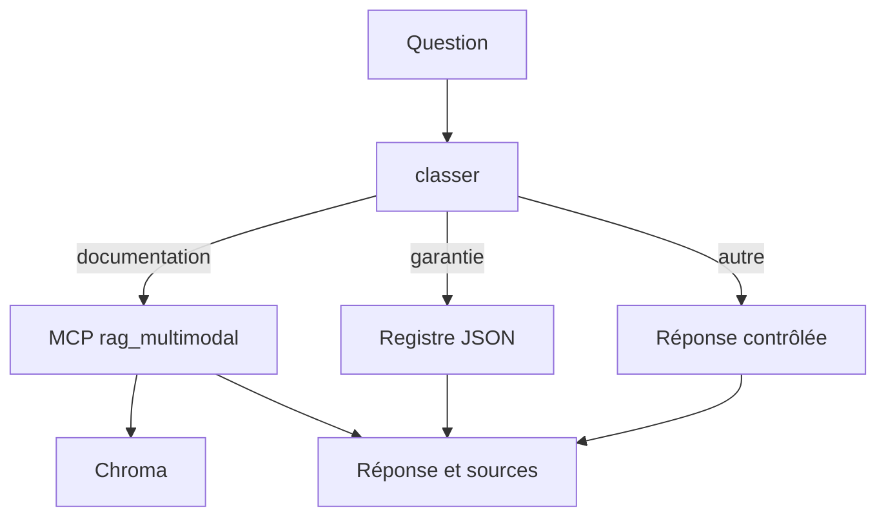

# Agentic AI Lab

Laboratoire d'ingénierie des agents IA. Le dépôt réunit des agents LangChain, des graphes LangGraph, deux serveurs MCP en transport Streamable HTTP, un RAG documentaire et un assistant de support après-vente. Les exemples s'exécutent hors ligne avec un modèle scripté et des embeddings locaux. Les fournisseurs cloud restent optionnels.

## Objectifs d'apprentissage

- Construire un agent avec `langchain.agents.create_agent`, des outils typés et une mémoire de fil.
- Ajouter des middlewares de prompt, de modèle, d'erreur, de garde-fous et de validation humaine.
- Composer un graphe LangGraph explicite, avec état typé, arêtes conditionnelles, cycle borné et checkpointer.
- Exposer et consommer des outils MCP sans confondre Streamable HTTP et l'ancien transport SSE.
- Router une demande de support vers un seul agent spécialisé, puis terminer.

## Technologies

- Python 3.11 ou 3.12
- LangChain 1.4+ et LangGraph 1.2+
- FastMCP et `langchain.mcp.MCPAdapter`
- Chroma, pypdf et des embeddings configurables
- Streamlit
- Un workflow n8n importable

`DuckDuckGoSearchRun` et `PythonREPLTool` proviennent encore de `langchain-community` et `langchain-experimental`. Ces paquets sont signalés comme en fin de maintenance par leurs auteurs. Le REPL est désactivé par défaut et n'accepte qu'une expression arithmétique.

## Fonctionnalités

### Partie A — LangChain

- Agent conversationnel et outils d'addition, de multiplication, de date et d'analyse de texte.
- Mémoire courte par `thread_id`, avec exemple SQLite optionnel.
- Recherche DuckDuckGo, recherche Tavily et REPL Python restreint.
- Middlewares `dynamic_model`, `dynamic_prompt`, `tool_error_handling`, garde-fous et `HumanInTheLoopMiddleware`.
- Agent RAG sur un corpus Markdown, avec citations de titre et de page.

### Partie B — LangGraph

- Graphes linéaire, conditionnel, à réducteur, cyclique et avec checkpointer.
- Graphe RAG : routage, recherche, évaluation, reformulation bornée et réponse.
- `langgraph.json` pour LangGraph Studio.
- Interface Streamlit branchée sur le graphe RAG.

### Partie C — MCP

- Serveur de démonstration : `add_numbers` et `web_search`.
- Guide MCP Inspector.
- Client LangChain sur l'URL Streamable HTTP.
- Workflow n8n importable, non exécuté dans cet environnement.

### Partie D — Support client

- Orchestrateur qui choisit exactement un agent.
- Agent documentaire via l'outil MCP `rag_multimodal`.
- Index de manuels fictifs, figures et mode vision ou texte dégradé.
- Agent garantie et outil local `consulter_garantie`.
- Interface Streamlit en français.

## Structure du dépôt

```text
agentic-ai-lab/
  langchain_agents/        agents, outils, middlewares et RAG pédagogique
  langgraph_workflows/     graphes et application Streamlit RAG
  mcp_integration/         serveur, client et workflow n8n
  customer_support/        orchestrateur, RAG technique et support
  shared/                  configuration, modèles et index
  tests/                   pytest, sans clé API
  docs/                    architecture, installation, captures
  langgraph.json
```

Les notebooks et le support de cours déjà présents dans le dossier local ne font pas partie du code publié : ils sont ignorés par Git.

## Architecture





Le détail des flux A, B, C et D est dans [docs/architecture.md](docs/architecture.md).

## Prérequis

- Python 3.12 recommandé, 3.11 accepté
- Un terminal
- Facultatif : clé OpenAI, Google ou Tavily, Node.js pour l'inspecteur MCP, n8n, LangGraph Studio

## Installation

Le pas à pas est aussi dans [docs/setup.md](docs/setup.md).

Linux et macOS :

```bash
python3.12 -m venv .venv
source .venv/bin/activate
python -m pip install --upgrade pip
python -m pip install -r requirements.txt
cp .env.example .env
```

Windows PowerShell :

```powershell
py -3.12 -m venv .venv
.\.venv\Scripts\Activate.ps1
python -m pip install --upgrade pip
python -m pip install -r requirements.txt
Copy-Item .env.example .env
```

## Variables d'environnement

Le modèle de fichier est `.env.example`. Les valeurs utiles :

| Variable | Rôle |
| --- | --- |
| `LLM_PROVIDER` | `openai`, `google`, `ollama` ou `fake` |
| `LLM_MODEL` | Modèle de chat, par défaut `gpt-4o-mini` |
| `VISION_MODEL` | Modèle de vision, utilisé seulement si une clé existe |
| `EMBEDDING_PROVIDER` | `hash`, `openai` ou `google` |
| `TAVILY_API_KEY` | Recherche web. Sans clé, l'outil retourne une erreur |
| `MCP_DEMO_URL` | Serveur de démonstration, défaut `http://127.0.0.1:8000/mcp` |
| `MCP_RAG_URL` | Serveur documentaire, défaut `http://127.0.0.1:8001/mcp` |
| `AGENTIC_ALLOW_PYTHON_REPL` | `false` par défaut. Ne pas l'activer dans une application web |

Aucune clé n'est écrite dans le dépôt. Les journaux masquent les motifs de secret.

## Exemples LangChain

Avec un fournisseur cloud configuré, retirer `LLM_PROVIDER=fake`. Sans clé, cette variable est nécessaire : le programme s'arrête au lieu d'inventer une réponse de modèle.

```bash
LLM_PROVIDER=fake python -m langchain_agents.basic_agent --message "Combien font 2 + 3 ?"
LLM_PROVIDER=fake python -m langchain_agents.memory_agent --thread-id fil-a --message "Je m'appelle Salma" --message "Rappelle le fil."
LLM_PROVIDER=fake python -m langchain_agents.middleware_examples --scenario all
EMBEDDING_PROVIDER=hash python -m langchain_agents.rag.ingest
LLM_PROVIDER=fake python -m langchain_agents.rag.agent --question "Quel est l'objectif du laboratoire ?"
```

La mémoire courte est la liste des messages du checkpointer. Deux `thread_id` ne la partagent pas. `CHECKPOINT_PATH` et `SqliteSaver` montrent une mémoire qui peut survivre au processus. Le modèle scripté ne déduit pas le prénom : il confirme les messages reçus. L'historique conservé, lui, contient bien les tours précédents.

`PythonREPLTool` n'est pas monté dans Streamlit. La démonstration locale exige `AGENTIC_ALLOW_PYTHON_REPL=true` et une expression telle que `2 + 2`.

## Exemples LangGraph

```bash
python -m langgraph_workflows.fundamentals.linear
python -m langgraph_workflows.fundamentals.conditional
python -m langgraph_workflows.fundamentals.reducer_example
python -m langgraph_workflows.fundamentals.cycle
python -m langgraph_workflows.fundamentals.checkpoint
python -m langgraph_workflows.agentic_rag.graph --question "Quel est l'objectif du laboratoire Agentic AI Lab ?"
```

Le cycle s'arrête lorsque `valeur` atteint `limite`. Le graphe RAG s'arrête après deux reformulations si aucun passage n'est assez proche de la question.

## LangGraph Studio

`langgraph-cli` n'est pas dans `requirements.txt`. Installation et démarrage :

```bash
python -m pip install "langgraph-cli[inmem]"
langgraph dev --port 2024 --no-browser
```

Le fichier `langgraph.json` expose les graphes `lineaire`, `conditionnel`, `reducteur`, `cycle`, `memoire`, `rag_agentique` et `support_client`.

Le graphe exporté sous le nom `graph` dans `checkpoint.py` est compilé sans checkpointer personnalisé : LangGraph API refuse de charger un `InMemorySaver` fourni par le module. La démonstration locale et les tests utilisent `graph_avec_memoire`, qui conserve `InMemorySaver`.

Vérification du 20 novembre 2026, API locale `http://127.0.0.1:2024` :

- `GET /ok` a répondu `{"ok": true}`.
- `POST /assistants/search` a listé les sept graphes.
- `lineaire` avec `{"message": "Salma"}` a répondu `Bonjour Salma, bienvenue dans le graphe linéaire.`
- `rag_agentique` avec `{"question": "bonjour"}` a répondu sans lancer de recherche documentaire.

Ouvrir ensuite :

```text
https://smith.langchain.com/studio/?baseUrl=http://127.0.0.1:2024
```

L'URL ci-dessus est celle affichée par `langgraph-cli` 0.4.43 avec `langgraph-api` 0.18.3, la dernière version publiée. Deux contrôles restent distincts :

1. Chrome refuse qu'une page HTTPS appelle `http://127.0.0.1` tant que l'accès au réseau local n'est pas autorisé. Le message est `Failed to fetch`.
2. `langgraph-api` 0.18.3 répondait `400 Disallowed CORS private-network` à la prérequête, parce que `ALLOW_PRIVATE_NETWORK` n'est pas transmis à `CORSMiddleware`. Ni `http.cors`, ni une variable d'environnement, ni une option du CLI ne corrigent ce refus. Le correctif durable est `langgraph_workflows/studio_cors.py`, chargé par `http.app` dans `langgraph.json`. C'est le mécanisme officiel de middleware personnalisé. Il ne modifie pas les fichiers de `.venv` et reste présent après une réinstallation des dépendances.

Le 20 novembre 2026, après ce chargement et sans correctif dans `.venv`, la prérequête a répondu `200` avec `Access-Control-Allow-Private-Network: true`. Les sept graphes étaient listés. Avec l'accès local autorisé, Studio a affiché `reducteur` : `__start__` → `premiere` → `seconde` → `__end__`. La capture est `docs/screenshots/langgraph-studio.png`. Le bandeau `LANGSMITH_API_KEY` concerne seulement le traçage.

Si le navigateur refuse encore `127.0.0.1`, relancer avec un tunnel HTTPS :

```bash
langgraph dev --port 2024 --no-browser --tunnel
```

Le binaire `cloudflared` est mis en cache dans `~/.langgraph_api`. Le téléchargement par Python a échoué ici à cause du magasin de certificats de Python. `curl` a pu installer la version `2025.2.1`. Le serveur actuellement actif n'utilise pas le tunnel.

Exemples d'entrées :

```json
{"message": "Salma"}
```

```json
{"nombre": 4}
```

```json
{"valeur": 0, "limite": 3}
```

```json
{"question": "Quel est l'objectif du laboratoire Agentic AI Lab ?"}
```

```json
{"question": "Mon imprimante PX-200 affiche un voyant clignotant.", "reference_image": "img_px200_01"}
```

Le graphe `memoire` demande un `thread_id` dans la configuration de l'exécution. Les entrées ci-dessus sont des exemples de charge utile. La capture réelle est `docs/screenshots/langgraph-studio.png`.

## Serveurs MCP

```bash
python -m mcp_integration.server
python -m customer_support.mcp_server.server
```

| Serveur | Port | URL | Outils |
| --- | --- | --- | --- |
| Démonstration | 8000 | `http://127.0.0.1:8000/mcp` | `add_numbers`, `web_search` |
| Documentation | 8001 | `http://127.0.0.1:8001/mcp` | `rag_multimodal` |

`web_search` utilise Tavily seulement si `TAVILY_API_KEY` est définie. Sinon le résultat est `ok: false` et la liste de pages reste vide.

## MCP Inspector

Avec le serveur de démonstration déjà démarré :

```bash
npx @modelcontextprotocol/inspector
```

Dans l'inspecteur :

1. Choisir le transport Streamable HTTP, pas SSE.
2. Saisir `http://127.0.0.1:8000/mcp`.
3. Connecter, puis lister les outils.
4. Exécuter `add_numbers` avec `a=2` et `b=3`. Le résultat attendu est `5`.
5. Exécuter `web_search` avec une requête courte. Sans clé Tavily, la réponse explique l'absence de clé et ne contient pas de pages.

Pour le second serveur, utiliser `http://127.0.0.1:8001/mcp` et l'outil `rag_multimodal`.

Le 20 novembre 2026, le CLI `@modelcontextprotocol/inspector` a appelé les serveurs déjà démarrés, en transport HTTP :

- `tools/list` sur le port 8000 a retourné `add_numbers` et `web_search`.
- `add_numbers` avec `a=2` et `b=3` a retourné `structuredContent.result` égal à `5`, `isError` égal à `false`.
- `web_search` avec la requête `langgraph` a retourné `ok: false`, la liste `results` vide et le message `TAVILY_API_KEY est absente. Aucune recherche n'a été envoyée.` Aucune recherche live n'a été effectuée.
- `rag_multimodal` sur le port 8001, question sur le voyant papier de la PX-200 et référence `img_px200_01`, a retourné `ok: true`, `pertinent: true` et `mode_visuel: texte_degrade`. La réponse indique qu'aucune image binaire n'a été analysée par un modèle de vision.

L'interface graphique de l'inspecteur n'a pas été ouverte. Il n'y a donc pas de capture.

## Workflow n8n

Le fichier importable est `mcp_integration/n8n/workflow.json`. Il contient un déclencheur de chat, un nœud AI Agent, un modèle de chat OpenAI et un nœud MCP Client Tool en transport `httpStreamable`.

1. Dans n8n, importer le JSON. Le 20 novembre 2026, l'image `n8nio/n8n:latest` (2.48.7) a importé ce fichier dans un conteneur isolé sur `http://127.0.0.1:5678`. Le workflow s'appelle `Agentic AI Lab — client MCP` et reste inactif.
2. Au premier lancement, créer le compte propriétaire dans l'interface. Ce mot de passe reste dans le volume Docker `agentic-ai-lab-n8n`. Ne pas l'écrire dans le dépôt.
3. Créer un identifiant OpenAI dans l'interface n8n et le relier au nœud de modèle. L'identifiant du JSON, `REMPLACER_APRES_IMPORT`, n'est pas une clé. Aucune clé n'a été fournie au conteneur.
4. Définir `MCP_DEMO_URL`. Depuis le conteneur, `127.0.0.1` désigne n8n, pas le serveur Python.
5. Sur cette machine, `host.docker.internal:8000` atteint un autre conteneur Docker, pas le MCP Python qui n'écoute que sur `127.0.0.1:8000`. Un relais local `0.0.0.0:18000` vers `127.0.0.1:8000` a été ouvert, et le conteneur a `MCP_DEMO_URL=http://host.docker.internal:18000/mcp`. Une requête depuis le conteneur a reçu la réponse uvicorn du serveur MCP. `N8N_BLOCK_ENV_ACCESS_IN_NODE=false` permet au nœud de lire cette variable.
6. Démarrer le serveur Python et le relais avant d'ouvrir le chat n8n.
7. Demander une addition, par exemple `2 + 3`.

L'agent n8n n'a pas appelé `add_numbers` : le compte propriétaire n'est pas créé et aucune clé OpenAI n'est configurée. L'appel de l'agent et le résultat `5` sont **NOT TESTED**. L'import et l'accès réseau au MCP, eux, ont été vérifiés.

Les `typeVersion` du fichier ont été comparées au code courant de `n8n-io/n8n` (branche `master`, consultée le 20 novembre 2026) :

| Nœud | Version du fichier | Versions encore déclarées | Version par défaut |
| --- | --- | --- | --- |
| `chatTrigger` | 1.1 | 1, 1.1, 1.2, 1.3, 1.4, 1.5 | — |
| `agent` | 1.7 | 1 à 1.9, 2, 2.1, 2.2, 2.3, 3, 3.1 | 3.1 |
| `lmChatOpenAi` | 1.2 | 1, 1.1, 1.2, 1.3 | — |
| `mcpClientTool` | 1.2 | 1, 1.1, 1.2, 1.3, 1.4 | 1.4 |
| `stickyNote` | 1 | 1 | 1 |

La version 1.7 de l'agent et la version 1.2 du client MCP restent acceptées. Elles ne sont plus les versions par défaut. Un n8n récent peut proposer de les mettre à jour à l'import. Le transport du client est `httpStreamable`, pris en charge à partir de la version 1.2.

## Applications Streamlit

```bash
streamlit run langgraph_workflows/streamlit_app.py
streamlit run customer_support/app.py
```

L'application RAG affiche l'historique, les sources, un téléversement PDF, Markdown ou TXT, un indicateur de chargement et un bouton pour effacer la conversation. L'application de support ajoute la référence d'image, le numéro de série, la catégorie détectée, l'agent choisi et le détail de garantie.

Le 20 novembre 2026, Chrome a ouvert les deux applications. Les captures réelles sont dans `docs/screenshots/`. `AppTest` avait déjà obtenu les mêmes réponses.

- RAG, question sur l'objectif du laboratoire : réponse citant le guide, page 1.
- Documentation, référence `img_px200_01` : catégorie `documentation`, agent `agent_documentaire` seulement, mode `texte_degrade`.
- Garantie, série `PX200-0042` : catégorie `garantie`, agent `agent_garantie` seulement, statut `couverte` jusqu'au 2027-11-01.

Le même routage exclusif a été confirmé par l'API LangGraph `support_client` sur `http://127.0.0.1:2024`. Studio affiche maintenant les sept graphes. Voir la section LangGraph Studio.

## Questions d'exemple

Documentation :

> Mon imprimante PX-200 affiche un voyant clignotant. Que signifie le pictogramme sur la photo jointe ?

Référence : `img_px200_01`.

Chemin attendu : documentation, `agent_documentaire`, outil MCP `rag_multimodal`, réponse finale. Sans modèle de vision, la réponse indique le mode texte dégradé et cite le manuel fictif.

Garantie :

> Est-ce que mon imprimante est encore sous garantie ? Son numéro de série est PX200-0042.

Chemin attendu : garantie, `agent_garantie`, outil local `consulter_garantie`. Le statut dépend de la date du jour et de la durée enregistrée. Il n'est pas stocké dans le JSON.

## Tests

```bash
pytest
```

La suite couvre les outils, la mémoire, les cinq middlewares, les graphes, le routage exclusif, un numéro inconnu, l'image absente, le MCP indisponible, une clé manquante, une entrée vide, un document refusé, une référence d'image malveillante, une question sans passage pertinent et l'arrêt des graphes.

Lors de la vérification du 20 novembre 2026, après le correctif CORS de Studio, la commande a produit : **44 passed, 3 warnings** en 3,29 s. Les trois avertissements concernent le caractère bêta de `langchain.mcp` et la fin de maintenance annoncée de `langchain-experimental` et `langchain-community`. Cette ligne décrit cette exécution ; elle ne garantit pas un résultat identique sur une autre machine.

Les tests MCP démarrent réellement les serveurs Streamable HTTP. Ils ne remplacent pas une panne par un succès simulé.

## Captures d'écran

Captures prises dans Chrome le 20 novembre 2026 :

- [RAG, objectif du laboratoire](docs/screenshots/streamlit-rag.png), après la question réelle
- [Support, documentation du voyant](docs/screenshots/streamlit-support-documentation.png), après la question réelle
- [Support, garantie PX200-0042](docs/screenshots/streamlit-support-garantie.png), après la question réelle
- [Studio, graphe reducteur](docs/screenshots/langgraph-studio.png)

L'interface graphique de MCP Inspector et l'exécution de l'agent n8n n'ont pas de capture. Voir [docs/screenshots/LISEZMOI.md](docs/screenshots/LISEZMOI.md).

## Dépannage

- `OPENAI_API_KEY est absente` : renseigner la clé ou lancer l'exemple avec `LLM_PROVIDER=fake`.
- `TAVILY_API_KEY est absente` : comportement attendu de `web_search` sans clé.
- `Serveur MCP injoignable` : démarrer le module serveur correspondant et vérifier l'URL.
- Port déjà pris : changer `MCP_DEMO_PORT` ou `MCP_RAG_PORT`, puis l'URL.
- Studio affiche `Failed to fetch` : vérifier `http://127.0.0.1:2024/ok`, puis autoriser l'accès de Chrome au réseau local. La prérequête doit répondre `200`, grâce à `langgraph_workflows/studio_cors.py`.
- Depuis Docker, `127.0.0.1` désigne le conteneur, pas la machine hôte.
- Un document `.exe` ou un chemin `../` est refusé avant toute lecture.

## Sécurité et limites

- Les secrets restent dans l'environnement. `.env` est ignoré par Git.
- Les références d'image doivent avoir la forme `img_nom`. Un chemin n'est jamais accepté comme référence.
- Les images déposées sont enregistrées sous un nom aléatoire, dans un répertoire autorisé, avec une taille maximale de 5 Mo.
- Le REPL Python n'est pas exposé aux applications de support.
- Le mode texte dégradé ne prétend pas avoir interprété les pixels. `decrire_image` n'est appelé que si `image_path` contient un fichier autorisé. La seule référence `img_px200_01` utilise la description du catalogue et reste en `texte_degrade`, même si une clé existe. Avec un fichier, le modèle n'est construit que si `OPENAI_API_KEY` est défini et `VISION_MODEL` ne commence pas par `gemini`, ou si `GOOGLE_API_KEY` est défini et le modèle commence par `gemini`. La valeur par défaut est `gpt-4o-mini`. Aucune clé n'était définie : la vision réelle des pixels est **NOT TESTED**.
- Les embeddings `hash` comparent des mots. Ils ne remplacent pas un modèle sémantique.
- Le modèle scripté sert aux démonstrations et aux tests. Il ne constitue pas une évaluation de qualité d'un LLM.
- Les serveurs MCP écoutent par défaut sur `127.0.0.1`, sans authentification. Ne pas les exposer tels quels sur un réseau.

## Références de cours

Les concepts de serveur MCP et de RAG exposé comme outil sont adaptés, sans copie, des dépôts :

- [mohamedYoussfi/mcp-demo](https://github.com/mohamedYoussfi/mcp-demo)
- [mohamedYoussfi/agent-rag-as-tool-mcp-v2](https://github.com/mohamedYoussfi/agent-rag-as-tool-mcp-v2)

Correspondance avec le cours :

| Partie | Sujet | Point d'entrée |
| --- | --- | --- |
| A | Agents LangChain, outils, mémoire, middlewares, RAG | `langchain_agents/` |
| B | Graphes LangGraph, Studio, Streamlit RAG | `langgraph_workflows/`, `langgraph.json` |
| C | Serveur MCP, inspecteur, client, n8n | `mcp_integration/` |
| D | Support client, RAG multimodal, garantie | `customer_support/` |

Documentation utilisée pour les API :

- [LangChain](https://docs.langchain.com/oss/python/langchain/overview)
- [Middlewares](https://docs.langchain.com/oss/python/langchain/middleware/overview)
- [LangGraph](https://docs.langchain.com/oss/python/langgraph/overview)
- [MCP LangChain](https://docs.langchain.com/oss/python/langchain/mcp)
- [Model Context Protocol](https://modelcontextprotocol.io/)
- [SDK Python MCP](https://github.com/modelcontextprotocol/python-sdk)
- [Streamlit](https://docs.streamlit.io/)

Les vidéos du cours ne sont pas liées ici : leurs URL n'ont pas été vérifiées dans cet environnement. Utiliser les liens fournis par l'enseignant. Les notebooks de cours présents localement ne sont pas republies.

## Données fictives

Le manuel de l'imprimante PX-200, les schémas `img_px200_01` et `img_px200_02`, et le registre de garantie sont des créations pédagogiques. Ils ne décrivent pas un produit ni un fabricant réels. Le statut de garantie de `PX200-0042` est calculé à partir du 1er novembre 2025 et d'une durée de 24 mois.

## Auteur

- Nom : [À compléter]
- Établissement : [À compléter]
- Contact : [À compléter]

## Publication GitHub

Le dépôt Git local a été initialisé le 20 novembre 2026 pour vérifier `.gitignore`. Aucun commit n'a été créé, aucun dépôt GitHub n'a été créé, et rien n'a été poussé. `git status` ne liste ni `.env`, ni `.venv`, ni la photo `.heic`, ni le PDF de cours, ni les notebooks. `.env.example` reste visible. Ces commandes ne doivent être lancées qu'après une approbation explicite :

```bash
git status --short
git check-ignore -v .env .venv IMG_7470.heic "Support Résumé Agentic AI et MCP - Pr. YOUSSFI.pdf" agentic_ai_with_langchain_V3.ipynb demo-langgraph.ipynb
git add .
git status
git commit -m "Ajoute le laboratoire d'agents LangChain, LangGraph et MCP."
gh repo create agentic-ai-lab --source=. --remote=origin --private
git push -u origin HEAD
```

`.gitignore` exclut `.env`, `.venv`, les index Chroma, les bases SQLite, `.langgraph_api/`, la photo `.heic` et les supports de cours déjà présents dans le dossier. `.env.example` reste publiable. Ne pas forcer l'ajout des fichiers ignorés.
