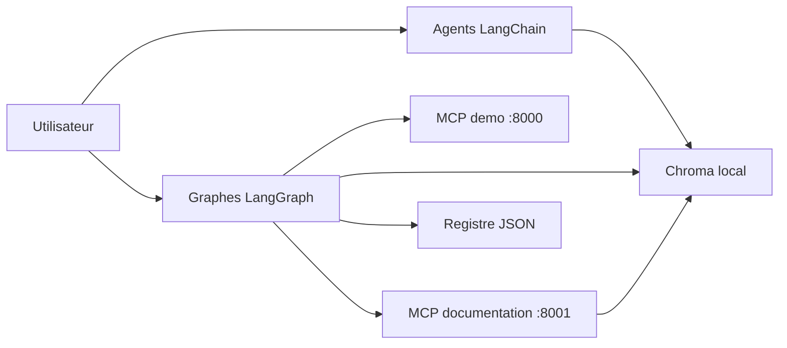
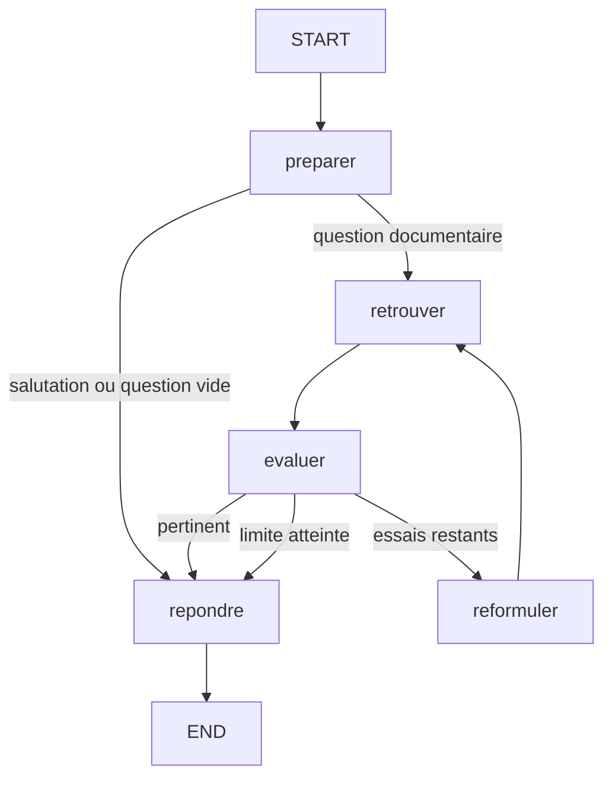
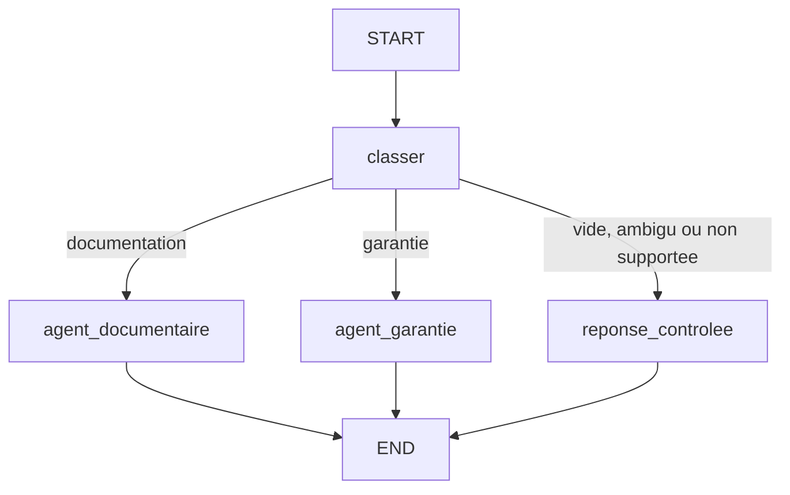

# Architecture

Ce document décrit les flux réellement implémentés dans le dépôt. Les serveurs MCP sont des processus séparés. Le 20 novembre 2026, l'API `langgraph dev` et le CLI MCP Inspector ont été exécutés. n8n n'était pas installé. Aucun navigateur n'a ouvert Studio, Streamlit ou l'inspecteur. La vision réelle des pixels n'a pas été exécutée : sans clé, le pipeline reste en `texte_degrade`.

## Vue d'ensemble

## Partie A — agent LangChain

`create_agent` assemble un modèle, des outils et des middlewares. Le checkpointer LangGraph conserve les messages d'un `thread_id`. L'outil de recherche lit Chroma et retourne des citations. Si le score de recouvrement est trop faible, l'outil demande explicitement de ne pas inventer.

## Partie B — graphe RAG

La reformulation n'ajoute pas le vocabulaire du corpus à une question hors sujet. Après deux reformulations, le graphe s'arrête et signale que les documents sont insuffisants.

## Partie C — MCP

Les deux serveurs utilisent FastMCP et le transport `streamable-http`. Le point d'accès est `/mcp`.

- `mcp_integration/server.py` expose `add_numbers` et `web_search`.
- `customer_support/mcp_server/server.py` expose `rag_multimodal`.
- Le client LangChain utilise `langchain.mcp.MCPAdapter` avec une URL HTTP. Une chaîne qui n'est pas une URL n'est pas acceptée par cet adaptateur, ce qui évite de lancer un fichier local par erreur.

## Partie D — support client

Une demande mixte ne lance aucun des deux agents. L'agent documentaire appelle uniquement l'outil MCP `rag_multimodal`. L'agent garantie lit uniquement `consulter_garantie`. Si le serveur documentaire ne répond pas, l'état contient une erreur et aucune réponse métier n'est fabriquée.

Le pipeline documentaire indexe le texte des manuels et les descriptions de figures. Un modèle de vision n'est appelé que si une clé correspondante est présente. Sinon le champ `mode_visuel` vaut `texte_degrade`.
